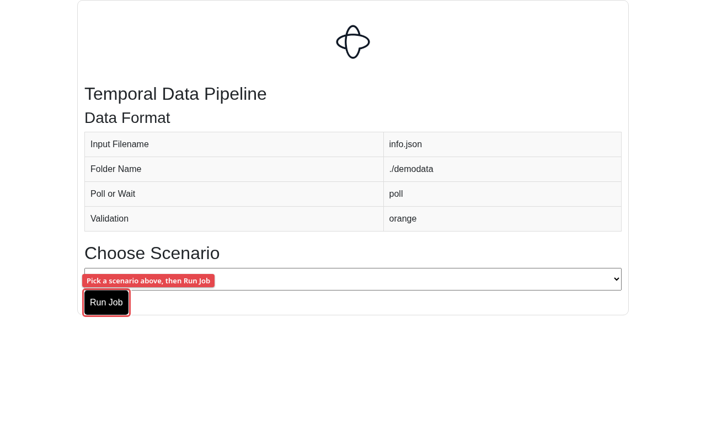
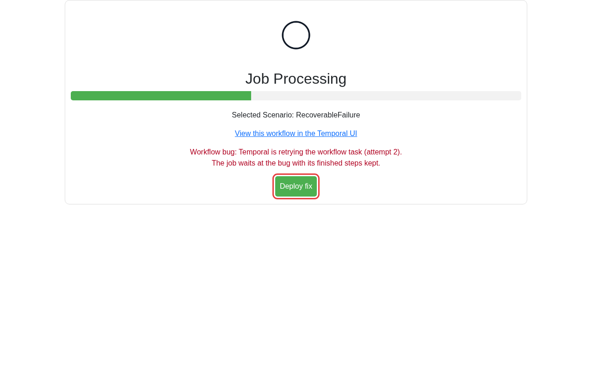

# Temporal Data Pipeline Demo

_Leveraging the Temporal Python SDK_

This demo illustrates how to build a data pipeline with Temporal using the Python SDK. It features a web UI and CLI interface for executing ETL workflows with various scenario demonstrations including error handling, human-in-the-loop patterns, and advanced visibility features.

To present the demo, follow the [runbook](RUNBOOK.md): what to click, what to say and the code behind each scenario.



| Prerequisites      |    | Features       |    | Patterns            |    |
|:-------------------|----|----------------|----|---------------------|----|
| Network Connection | ✅ | Schedule       |    | Entity              |    |
| GitHub Actions     |    | Local Activity | ✅ | Long-Running        | ✅ |
| Python 3.12        | ✅ | Timer          |    | Fanout              |    |
| uv 0.4+            | ✅ | Signal         | ✅ | Continue As New     |    |
|                    |    | Query          | ✅ | Manual Intervention | ✅ |
|                    |    | Heartbeat      | ✅ | Long-polling        |    |
|                    |    | Update         |    | Polyglot            |    |
|                    |    | Retry          | ✅ |                     |    |
|                    |    | Data Converter | |                     |    |
|                    |    | Codec Server   | |                     |    |
|                    |    | Custom Attrs   | ✅ |                     |    |
|                    |    | Worker Metrics |    |                     |    |
|                    |    | Side Effect    |    |                     |    |

## Quick Start with Docker

With only [Docker](https://docs.docker.com/get-docker/) (with Compose) and
[just](https://github.com/casey/just) installed:

```bash
git clone <repository-url>
cd temporal-data-pipeline-demo
just up
```

`just up` builds the image and starts a Temporal dev server, the worker and
the web UI (`compose.yaml`), and returns once they are healthy:

- Web UI: [http://localhost:8080](http://localhost:8080)
- Temporal Web UI: [http://localhost:8233](http://localhost:8233)

Without `just`, run `docker compose up --build --detach --wait`.

- `just logs` (or `just logs worker`) follows the logs.
- `just down` stops everything and removes the job files; the dev server keeps
  no history between runs.
- To use other host ports, set `DEMO_PORT` and `TEMPORAL_UI_PORT`, for example
  `DEMO_PORT=9080 just up`.
- To crash the worker mid-job, run `docker compose kill worker`, then
  `docker compose start worker`.
- After you change the code, run `just up` again: it rebuilds the image and
  replaces the worker, and running jobs carry on.
- Temporal's gRPC port stays inside Docker, so the stack runs beside a local
  `temporal server start-dev`. Use the CLI against it with
  `docker compose exec temporal temporal workflow list --address 127.0.0.1:7233`.

## Quick Start without Docker

### Prerequisites

* Python >= 3.11
* [uv package manager](https://docs.astral.sh/uv/)
* [Temporal CLI](https://docs.temporal.io/cli) for local development
* [Temporal Cloud account](https://cloud.temporal.io/) (optional, for production demos)

### Installation Steps

1. **Clone the repository**
   ```bash
   git clone <repository-url>
   cd temporal-data-pipeline-demo
   ```

2. **Install dependencies**
   ```bash
   # Install base dependencies
   uv sync
   
   # For development (includes linting/type checking tools)
   uv sync --extra dev
   ```

3. **Configure environment**
   ```bash
   # Copy example configuration
   cp .env.example .env
   
   # Edit .env with your settings (see Environment Configuration section)
   ```

4. **Start Temporal server**
   ```bash
   # For local development
   temporal server start-dev
   
   # Or using just
   just temporal-start
   ```

5. **Start the worker** (in a new terminal)
   ```bash
   uv run worker.py
   
   # Or using just
   just worker
   ```

   On startup the worker registers the `Step` search attribute the
   AdvancedVisibility scenario uses, if the namespace does not have it yet.

6. **Start the UI** (in another terminal)
   ```bash
   uv run gunicorn -b 0.0.0.0:8080 --threads 8 ui.app:app
   
   # Or using just
   just ui
   ```

7. **Access the demo**
   - Web UI: [http://localhost:8080](http://localhost:8080)
   - Temporal Web UI: [http://localhost:8233](http://localhost:8233)

## Demo Scenarios

### Web UI Demo Path

The web interface provides an intuitive way to demonstrate Temporal workflows to customers and attendees.

#### Basic Demo Flow

1. **Navigate to the Web UI** at [http://localhost:8080](http://localhost:8080)

2. **Submit a Job**
   - Select a scenario from the dropdown menu
   - Enter a unique Job ID (or use the generated one)
   - Click "Submit Job" to start the workflow

3. **Monitor Progress**
   - The job progress page shows real-time workflow execution
   - Progress bar updates as activities complete
   - View detailed logs and status information

4. **Explore Temporal Web UI**
   - Open [http://localhost:8233](http://localhost:8233)
   - Show workflow history, activity details, and timeline
   - Demonstrate workflow replay and debugging capabilities

#### Available Scenarios

**HappyPath** - Standard successful workflow execution
- **What happens:** Executes complete ETL pipeline (Validate → Extract → Transform → Load → Poll)
- **Key features:** Activity heartbeats, progress tracking, distributed task queues
- **Talking points:** "This shows the basic reliability of Temporal - even if workers crash, the workflow continues seamlessly"
- **Best for:** First-time demos, establishing baseline understanding

**AdvancedVisibility** - Custom search attributes and workflow metadata
- **What happens:** Same as HappyPath but updates custom "Step" search attribute at each phase
- **Key features:** Dynamic search attributes, workflow discoverability, business intelligence
- **Talking points:** "Watch how we can track exactly where each workflow is in real-time - perfect for dashboards and reporting"
- **Demo tip:** Show Temporal Web UI search functionality with `Step:validation` queries

**HumanInLoopSignal** - Manual intervention using Signals
- **What happens:** Workflow pauses after Load activity, waits for external signal to continue
- **Key features:** Asynchronous signals, external system integration, timeout handling
- **Talking points:** "This is how you handle approvals, external callbacks, or human decisions in your workflows"
- **Demo interaction:** Use `just signal-workflow <JOB_ID>` or Web UI button during 60-second wait
- **Timeout behavior:** Fails with "Load did not complete before timeout" if no signal received

**HumanInLoopUpdate** - Manual intervention using Updates
- **What happens:** Similar to Signal but uses synchronous Update mechanism
- **Key features:** Request-response pattern, immediate feedback, validation support
- **Talking points:** "Unlike signals, updates are synchronous - you get immediate confirmation and can validate the request"
- **Demo interaction:** Use Web UI update button to show immediate response
- **Timeout behavior:** Fails with "Load did not complete before timeout" if no update received

**Idempotency** - Duplicate activity execution testing
- **What happens:** Executes Load activity twice to demonstrate idempotency guarantees
- **Key features:** Activity idempotency, exactly-once semantics, duplicate detection
- **Talking points:** "Notice how the Load activity runs twice but produces the same result - Temporal guarantees exactly-once execution"
- **Demo tip:** Show activity history to highlight duplicate execution with same results

**RecoverableFailure** - A bug in workflow code, fixed while the job waits
- **What happens:** After the transform step the workflow code raises an exception. Temporal fails only the workflow task and keeps retrying it, so the job waits at the bug. The job page then shows a **Deploy fix** button: it sends this one job a `deploy_fix` Signal, which stands in for deploying fixed code, and the job resumes from the bug and completes
- **Key features:** Workflow task retries, durable progress across a code fix
- **Talking points:** "A bug doesn't lose the job: Temporal holds it where it failed, and once the fix is deployed it carries on with the finished steps kept"
- **Demo tip:** Show the failing workflow task's attempt count in the Temporal UI before clicking **Deploy fix**. Locally you can deploy a real fix instead: delete the bug's two lines in `DataPipelineWorkflowScenarios.py` and restart the worker



**NonRecoverableFailure** - Permanent business logic failure
- **What happens:** Validation activity fails (input.validation set to "blue"), workflow terminates
- **Key features:** Business rule enforcement, graceful failure handling, error propagation
- **Talking points:** "Some failures shouldn't be retried - this shows how to handle permanent business logic failures"
- **Demo tip:** Emphasize the difference between retryable infrastructure failures and non-retryable business failures

**APIFailure** - External service failure simulation with long-running retries
- **What happens:** Poll activity fails 9 times before succeeding on attempt 10
- **Key features:** Long-running retries, external service resilience, activity retry policies
- **Talking points:** "This simulates external API downtime - Temporal keeps retrying until the service recovers"
- **Demo tip:** Show the retry attempts building up in the activity history over time


### CLI Demo Path

For technical audiences or detailed demonstrations, use the CLI interface.

#### Basic CLI Operations

1. **Start a workflow**
   ```bash
   # Using just (recommended)
   just start-workflow HappyPath demo-001
   
   # Using Temporal CLI directly
   temporal workflow start \
     --workflow-id "job-demo-001" \
     --type "DataPipelineHappyPath" \
     --task-queue "data-pipeline" \
     --input '{"input_filename": "info.json", "foldername": "./demodata", "poll_or_wait": "poll", "validation": "orange", "scenario": "HappyPath", "key": "demo-001"}'
   ```

2. **Query workflow progress**
   ```bash
   just query-workflow demo-001
   
   # Or directly
   temporal workflow query --workflow-id "job-demo-001" --type "progress"
   ```

3. **Check workflow status**
   ```bash
   just workflow-status demo-001
   
   # Or directly
   temporal workflow describe --workflow-id "job-demo-001"
   ```

4. **Send signals (for HumanInLoopSignal scenario)**
   ```bash
   just signal-workflow demo-001
   
   # Or directly
   temporal workflow signal \
     --workflow-id "job-demo-001" \
     --name "load_complete_signal" \
     --input '"completed"'
   ```

#### Advanced CLI Demonstrations

**List all workflows**
```bash
temporal workflow list
```

**Show workflow history**
```bash
temporal workflow show --workflow-id "job-demo-001"
```

**Search workflows by scenario**
```bash
temporal workflow list --query 'WorkflowType = "DataPipelineAdvancedVisibility"'
```

**Cancel a running workflow**
```bash
temporal workflow cancel --workflow-id "job-demo-001"
```

**Terminate a workflow**
```bash
temporal workflow terminate --workflow-id "job-demo-001" --reason "Demo complete"
```

## Environment Configuration

### Local Development (Default)

No configuration needed. The demo connects to `localhost:7233`, namespace
`default`, and runs on the task queue `data-pipeline`.

### Temporal Cloud Configuration

The connection is read by the Temporal SDK's
[environment configuration](https://docs.temporal.io/develop/environment-configuration),
from environment variables (or a `temporal.toml` profile). Set them in your
shell or in `.env`:

```bash
# Temporal Cloud connection
TEMPORAL_ADDRESS=your-namespace.abc123.tmprl.cloud:7233
TEMPORAL_NAMESPACE=your-namespace.abc123
TEMPORAL_API_KEY=your-api-key
TEMPORAL_TLS=true

# Or mTLS certificates instead of an API key
TEMPORAL_TLS_CLIENT_CERT_PATH=/path/to/your/cert.pem
TEMPORAL_TLS_CLIENT_KEY_PATH=/path/to/your/key.key

# Optional: Enable payload encryption
ENCRYPT_PAYLOADS=true

# Task queue the workflows run on
TEMPORAL_TASK_QUEUE=data-pipeline

# Temporal UI each job links to
TEMPORAL_UI_URL=https://cloud.temporal.io
```

On Temporal Cloud, create the `Step` search attribute (Keyword) on the
namespace yourself: the worker can register it only on a dev server.

### Sessions and Files

Each browser gets its own session cookie, and its jobs' workflow IDs are
`pipeline-<session hash>-<job id>`, so concurrent visitors never see or signal each
other's jobs. Each job works in its own directories,
`demodata/working/<workflow id>/` and `demodata/output/<workflow id>/`.

### Container Image

The `Dockerfile` builds one image for both processes. It starts the web UI on
`$PORT` (default 8080); run the worker from the same image with
`python worker.py`. `compose.yaml` runs both, with a Temporal dev server, for
`just up`.

## Demo Tips for Trade Shows

### Preparation

1. **Pre-start services** before the demo to avoid wait times
2. **Clear previous demo data** using `just reset`
3. **Have both Web UI and Temporal Web UI** open in browser tabs
4. **Prepare specific job IDs** that relate to your audience (e.g., "customer-demo-2024")

### Recommended Demo Flow

1. **Start with HappyPath** to show basic workflow execution
2. **Show Temporal Web UI** to highlight observability features
3. **Demonstrate RecoverableFailure** to show reliability features
4. **Use HumanInLoopSignal** to show workflow interaction
5. **Finish with AdvancedVisibility** to show enterprise features

### Key Talking Points

- **Reliability**: Workflows survive process crashes and infrastructure failures
- **Observability**: Complete history and real-time monitoring
- **Scalability**: Distributed execution with automatic load balancing
- **Developer Experience**: Simple Python code with powerful platform features
- **Business Logic Focus**: Temporal handles infrastructure concerns

## Development

### Code Quality

```bash
# Run all quality checks
just check-all

# Individual commands
just lint        # Lint code with ruff
just format      # Format code with ruff  
just typecheck   # Type check with mypy
```

### Utility Commands

```bash
just clean       # Clean up temporary files
just reset       # Stop services and clean up
```

### Project Structure

```
temporal-data-pipeline-demo/
├── activities.py                    # ETL activities (extract, transform, load)
├── client.py                       # Temporal client configuration
├── worker.py                       # Temporal worker setup
├── DataPipelineWorkflowHappyPath.py # Standard workflow
├── DataPipelineWorkflowScenarios.py # Dynamic workflow for all scenarios
├── dataobjects.py                  # Data classes and exceptions
├── encryption_codec.py             # Optional payload encryption
├── Dockerfile                      # Image for the web UI and the worker
├── compose.yaml                    # Whole demo in Docker (just up)
├── ui/                            # Flask web interface
│   ├── app.py                     # Web application
│   └── templates/                 # HTML templates
├── demodata/                      # Sample data files
│   ├── source/                    # Input data
│   ├── working/                   # Processing directory
│   └── output/                    # Results
└── justfile                       # Development commands
```

## Troubleshooting

### Common Issues

**Port conflicts**: If port 7233 is in use, stop other Temporal servers with `just temporal-stop`. With `just up`, if 8080 or 8233 is in use, pick other ports with `DEMO_PORT` and `TEMPORAL_UI_PORT`

**Worker not starting**: Ensure Temporal server is running first

**Module import errors**: Run `uv sync` to install missing dependencies

**TLS certificate errors**: Verify certificate paths in `.env` are correct and files are readable

### Support

For issues specific to this demo, check the logs in your terminal windows. For Temporal platform questions, refer to the [Temporal documentation](https://docs.temporal.io/).