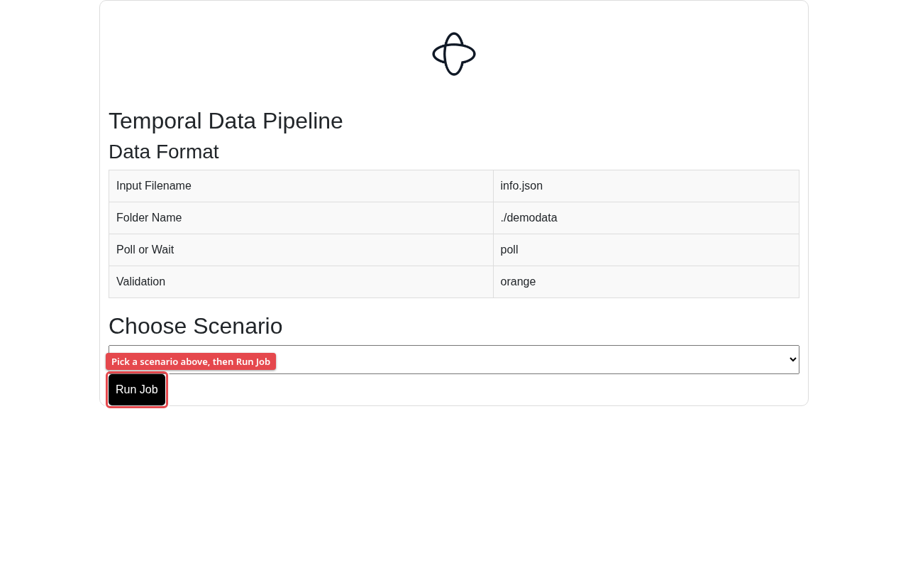
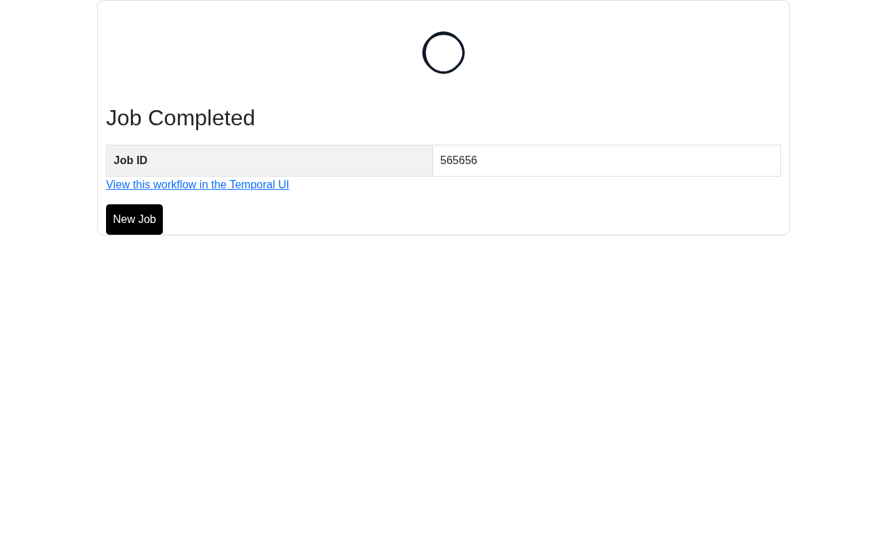
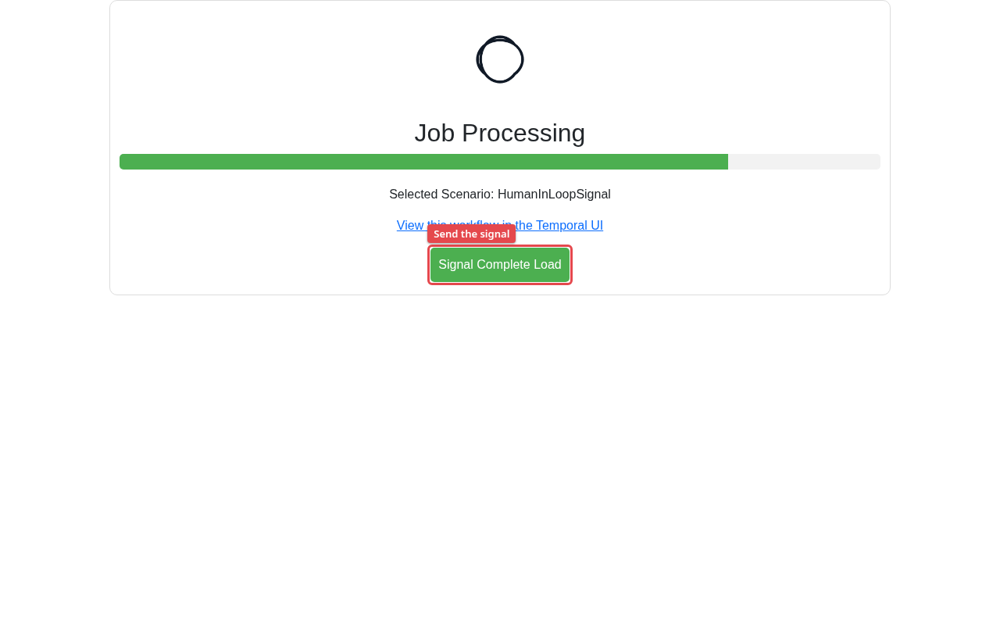

# Runbook: Temporal Data Pipeline

This runbook is for presenting the hosted copy of the demo from the Temporal
demo catalog. Running it on a laptop is covered in [Run it locally](#run-it-locally).

## What it shows

An ETL job (validate, extract, transform, load, poll) runs as a Temporal
Workflow. Eight scenarios, picked from one dropdown, show what Temporal does
when that job meets real-world trouble:

- A flaky downstream API: retries happen without any retry code in the job.
- Bad input: a business failure stops the job at once instead of retrying.
- A bug in the job's code: the job pauses at the bug and resumes when it is fixed.
- A person has to approve a step: the job waits for a Signal or an Update.
- A step runs twice: an idempotency key keeps the load from repeating.
- Operators need to find jobs by stage: a custom Search Attribute tracks the step.

## Before you start

- Open the demo from its entry in the catalog. Its host is `data-pipeline` under
  the catalog's domain.
- The hosted demo is public: anyone with the URL can open it and start jobs, and
  no sign-in is needed. Each browser gets its own session, so other visitors
  cannot see, signal or update your jobs, and you cannot see theirs.
- The demo's Temporal namespace is published read-only at `/_temporal/primary/`
  on the demo's host. Every job page links its own execution there. Anyone can
  read every job's history there, so type nothing private into the demo.
- To crash the worker, start a crashable workspace from the catalog (it needs
  sign-in). It runs its own copy of the demo on its own Temporal dev server,
  with that server's UI at `/_temporal` on the workspace's host.

## Start it

1. Open the demo. The page shows **Temporal Data Pipeline**, the input data table
   (`info.json`, `./demodata`, `poll`, `orange`), a **Choose Scenario** dropdown and
   **Run Job**.

   

2. Each **Run Job** starts one Workflow. The job page shows **Job Processing**, a
   progress bar that moves 10, 20, 40, 60, 80, 100 percent, the scenario and the
   link **View this workflow in the Temporal UI**. At 100 percent the page turns into
   **Job Completed**.

   

A healthy start: a HappyPath job finishes in about 20 seconds.

## The walkthrough

Run the scenarios in the dropdown's order. For each, choose it, click **Run Job**,
and open **View this workflow in the Temporal UI** in a second tab.

### 1. HappyPath

- **Do:** run HappyPath.
- **The audience sees:** the bar climbs to 100 percent and **Job Completed**.
- **Say:** "Each stage is an Activity. Temporal records each result, so if the
  process running this job died between stages, the job would carry on from the
  last stage that finished, not from the start."
- **Proof:** the Event History in the Temporal UI: one `ActivityTaskScheduled` /
  `ActivityTaskCompleted` pair per stage, and `get_available_task_queue` first,
  which pins the file-handling stages to one worker
  ([Pin a job's file steps to one worker](#pin-a-jobs-file-steps-to-one-worker)).

### 2. AdvancedVisibility

- **Do:** run AdvancedVisibility.
- **The audience sees:** the same run as HappyPath.
- **Say:** "The job writes its current stage into a custom Search Attribute,
  `Step`, so operators can list every job stuck in, say, `load`."
- **Proof:** in the Temporal UI, filter the workflow list with `Step = "complete"`
  (or `"transform"` while one runs), and open the execution's search attributes.

### 3. HumanInLoopSignal

- **Do:** run HumanInLoopSignal. At 80 percent a **Signal Complete Load** button
  appears with a countdown. Click it within 60 seconds.

  

- **The audience sees:** the job completes as soon as the signal arrives. Without
  the click it fails after 60 seconds with "Load did not complete before timeout".
- **Say:** "The job waits for a person for as long as it needs to, without a
  thread or a database poll. A Signal is fire-and-forget: the sender doesn't hear
  back."
- **Proof:** `WorkflowExecutionSignaled` in the history, then the job finishing.

### 4. HumanInLoopUpdate

- **Do:** run HumanInLoopUpdate and click **Update Complete Load** within 60
  seconds.
- **The audience sees:** a result line, "Update for job_id ... accepted: Workflow
  update successful", and the job completes.
- **Say:** "An Update is the request-response version: the caller gets the
  workflow's answer, or an error if the update is rejected."
- **Proof:** `WorkflowExecutionUpdateAccepted` and `...Completed` in the history.

### 5. Idempotency

- **Do:** run Idempotency.
- **The audience sees:** a normal completion.
- **Say:** "The job runs the load step twice on purpose, as a retry after a
  timeout would. The second run finds the job's idempotency key and skips, so the
  data is loaded once."
- **Proof:** the second `load` Activity's result in the history:
  "idempotency key ... found, skipping...".

### 6. APIFailure

- **Do:** run APIFailure.
- **The audience sees:** the bar stops at 80 percent for about 20 seconds, then
  the job completes.
- **Say:** "The polling step calls an API that fails nine times. Temporal retries
  it every 2 seconds under a retry policy; there is no retry loop in the code."
- **Proof:** in the Temporal UI, the pending `poll` Activity's attempt count and
  last failure "Poll failed: not found" while it retries; then its completion on
  attempt 10.

### 7. RecoverableFailure

- **Do:** run RecoverableFailure.
- **The audience sees:** the bar reaches 40 percent, then drops back to 0 and stays
  there: the page cannot read progress while the workflow's code is failing.
- **Say:** "This is a bug in the workflow code itself. Temporal doesn't fail the
  job: it keeps it paused at the bug and retries the workflow task, so after the
  fix is deployed the job resumes exactly where it was, with the transform
  already done."
- **Proof:** the Temporal UI shows a pending workflow task failing with
  "Workflow bug!" and its attempt count growing.
- **Hosted copy:** nobody can deploy the fix to it, so the job keeps retrying
  until its 30-minute execution timeout ends it. Fixing the bug and watching the
  job resume works only locally; see [Run it locally](#run-it-locally).

### 8. NonRecoverableFailure

- **Do:** run NonRecoverableFailure.
- **The audience sees:** the error "Workflow failed: job-..." in red under the bar.
- **Say:** "Validation rejected the input (`blue` instead of `orange`). That is a
  business failure, not an outage, so the job fails at once instead of retrying."
- **Proof:** `WorkflowExecutionFailed` with "Workflow failed due to validation".

### Optional: crash the worker (crashable workspace)

- **Do:** in a crashable workspace, run HumanInLoopSignal. When the signal button
  appears, use the workspace's crash action on the worker. When the worker is back,
  click **Signal Complete Load**.
- **The audience sees:** the job completes; the worker that started it no longer
  exists.
- **Say:** "The state of the job lives in Temporal, not in the worker. A new
  worker replays the history and continues."
- **Limit:** the extract, transform and load stages hand data to each other
  through files on the worker's own disk. A crash between extract and load
  loses those files, and the next stage fails. Crash the worker before the job
  starts, or once it reaches 80 percent.

## Show it in code

Code links point at the default branch; line numbers are as of this runbook.

### Give every browser its own jobs

**When to use it:** before the walkthrough, or when someone asks how several
visitors share one deployment.

**Where it is:** [`ui/app.py` lines 79-81](https://github.com/temporal-sa/temporal-data-pipeline-demo/blob/main/ui/app.py#L79-L81) (`code -g ui/app.py:79`)

```python
def workflow_id(job_id: str) -> str:
    session_key = hashlib.sha256(g.session_id.encode()).hexdigest()[:16]
    return f"pipeline-{session_key}-{job_id}"
```

**What you need to understand:**

- The session ID is a random token in the `pipeline_session` cookie. Every route
  turns a job number into this workflow ID, so a request can reach only its own
  session's jobs. The hash keeps the cookie out of the IDs the public Temporal UI
  shows.
- This is demo machinery: a real system would derive the ID from its own user or
  tenant identity. The point to make is that the Workflow ID is the business key
  Temporal deduplicates and addresses jobs by.

### Pin a job's file steps to one worker

**When to use it:** HappyPath, when `get_available_task_queue` appears in the
history.

**Where it is:** [`worker.py` lines 53-62](https://github.com/temporal-sa/temporal-data-pipeline-demo/blob/main/worker.py#L53-L62) (`code -g worker.py:53`)

```python
    # Comment line to see non-deterministic functionality
    random.seed(667)

    # Create the host-specific task queue and build task queue selection function
    task_queue: str = f"{TASK_QUEUE}-host-{UUID(int=random.getrandbits(128))}"

    @activity.defn(name="get_available_task_queue")
    async def select_task_queue() -> str:
        """Randomly assign the job to a queue"""
        return task_queue
```

**What you need to understand:**

- Each worker serves two Task Queues: the shared `TEMPORAL_TASK_QUEUE` and its own
  host queue. The workflow's first Activity runs on the shared queue and returns
  the host queue of whichever worker picked it up; extract, transform and load
  then run with `task_queue=unique_worker_task_queue`, so they share that worker's
  disk.
- The seed makes the host queue name the same across restarts, so a replacement
  worker serves the queue its predecessor left. The files on the old worker's disk
  are still gone: see the crash limit above.
- Docs: [Worker-specific Task Queues](https://docs.temporal.io/task-routing#route-activity-tasks-to-a-specific-host).

### Search by pipeline stage

**When to use it:** AdvancedVisibility.

**Where it is:** [`DataPipelineWorkflowScenarios.py` lines 56-58](https://github.com/temporal-sa/temporal-data-pipeline-demo/blob/main/DataPipelineWorkflowScenarios.py#L56-L58) (`code -g DataPipelineWorkflowScenarios.py:56`)

```python
        # Advanced Visibility scenario
        if self.VISIBILITY == workflow_type:
            workflow.upsert_search_attributes({"Step": ["validation"]})
```

**What you need to understand:**

- `Step` is a Keyword Search Attribute. The hosted namespace has it declared; on a
  dev server the worker registers it at startup (`ensure_step_search_attribute`
  in `worker.py`).
- The workflow upserts it again at `extract`, `transform`, `load` and `complete`.
  Each upsert is recorded in the history, so it is deterministic on replay.
- Docs: [Search Attributes](https://docs.temporal.io/search-attribute).

### Wait for a person with a Signal or an Update

**When to use it:** HumanInLoopSignal and HumanInLoopUpdate.

**Where it is:** [`DataPipelineWorkflowScenarios.py` lines 143-152](https://github.com/temporal-sa/temporal-data-pipeline-demo/blob/main/DataPipelineWorkflowScenarios.py#L143-L152) and the handlers at [lines 184-191](https://github.com/temporal-sa/temporal-data-pipeline-demo/blob/main/DataPipelineWorkflowScenarios.py#L184-L191) (`code -g DataPipelineWorkflowScenarios.py:143`)

```python
        # Human In the Loop (signal) scenario
        if self.SIGNAL == workflow_type:
            try:
                await workflow.wait_condition(lambda: self.signal_received, timeout=60)
                # ...
            except TimeoutError as e:
                # could return "Load did not complete before timeout."
                raise temporalio.exceptions.ApplicationError("Load did not complete before timeout") from e
# ...
    @workflow.signal
    async def load_complete_signal(self, complete: str) -> None:
        self.signal_received = True

    @workflow.update
    async def load_complete_update(self, complete: str) -> str:
        self.update_received = True
        return "Workflow update successful"
```

**What you need to understand:**

- `wait_condition` with a timeout is a durable timer: the workflow holds no
  thread while it waits, and a restarted worker picks up the wait.
- The 60 seconds is a demo value; a real approval could wait days.
- A Signal returns nothing to the sender; an Update returns the handler's result,
  which the page prints.
- Docs: [Message passing](https://docs.temporal.io/develop/python/workflows/message-passing).

### Skip a load that already happened

**When to use it:** Idempotency.

**Where it is:** [`activities.py` lines 71-78](https://github.com/temporal-sa/temporal-data-pipeline-demo/blob/main/activities.py#L71-L78) (`code -g activities.py:71`)

```python
async def load(input: DataPipelineParams) -> str:
    try:
        keyExists = is_idempotent(input.key)
    except OSError as e:
        raise ApplicationError(f"Failed to read idempotency key: {e}", non_retryable=True) from e

    if keyExists:
        return "idempotency key " + input.key + " found, skipping... "
```

**What you need to understand:**

- Temporal runs an Activity at least once, so an Activity with side effects
  should be idempotent. The key is the job's Workflow ID.
- The demo keeps the keys in a file on the worker; a real system keeps them in the
  target store, ideally in the same transaction as the write.
- Docs: [Idempotency](https://docs.temporal.io/activity-definition#idempotency).

### Retry a flaky API without retry code

**When to use it:** APIFailure.

**Where it is:** [`activities.py` lines 107-111](https://github.com/temporal-sa/temporal-data-pipeline-demo/blob/main/activities.py#L107-L111) and the retry policy at [`DataPipelineWorkflowScenarios.py` lines 165-172](https://github.com/temporal-sa/temporal-data-pipeline-demo/blob/main/DataPipelineWorkflowScenarios.py#L165-L172) (`code -g activities.py:107`)

```python
async def poll(input: DataPipelineParams, workflow_type: str) -> str:
    if ErrorAPIUnavailable == workflow_type:
        if activity.info().attempt < 10:
            raise Exception("Poll failed: not found")
        return "polled successfully: found"
```

```python
            activity_output = await workflow.execute_activity(
                poll,
                args=[input, workflow_type],
                task_queue=unique_worker_task_queue,
                start_to_close_timeout=timedelta(seconds=3000),
                heartbeat_timeout=timedelta(seconds=20),
                retry_policy=RetryPolicy(initial_interval=timedelta(seconds=2), backoff_coefficient=1),
            )
```

**What you need to understand:**

- The failure is injected by attempt number; that part is demo machinery.
- The retry policy retries every 2 seconds (`backoff_coefficient=1`) with no
  attempt limit; the default policy would back off exponentially.
- Docs: [Retry Policies](https://docs.temporal.io/encyclopedia/retry-policies).

### Stop on bad input, pause on a bug

**When to use it:** NonRecoverableFailure and RecoverableFailure.

**Where it is:** [`DataPipelineWorkflowScenarios.py` lines 70-72](https://github.com/temporal-sa/temporal-data-pipeline-demo/blob/main/DataPipelineWorkflowScenarios.py#L70-L72) and [lines 106-109](https://github.com/temporal-sa/temporal-data-pipeline-demo/blob/main/DataPipelineWorkflowScenarios.py#L106-L109) (`code -g DataPipelineWorkflowScenarios.py:70`)

```python
        if not validation:
            workflow.logger.info(f"Validation rejected for: {input.input_filename}")
            raise ApplicationError("Workflow failed due to validation") from CustomException("Validation Failed")
# ...
        # Non-Recoverable (bug) Scenario
        if self.BUG == workflow_type:
            # Comment out to fix recoverable scenario and uncomment pass
            raise Exception("Workflow bug!")
```

**What you need to understand:**

- An `ApplicationError` raised in workflow code fails the Workflow Execution.
- Any other exception in workflow code fails only the workflow task, which
  Temporal retries: the execution stays open, waiting for fixed code. (The
  comment above the bug says "Non-Recoverable"; the scenario that runs it is
  RecoverableFailure.)
- The web UI starts every job with a 30-minute execution timeout
  ([`ui/app.py` line 23](https://github.com/temporal-sa/temporal-data-pipeline-demo/blob/main/ui/app.py#L23)),
  which ends a job nobody fixes or answers.
- Docs: [Error handling in Python](https://docs.temporal.io/develop/python/best-practices/error-handling).

## Reset and tear down

There is nothing to reset: every **Run Job** is a new Workflow with its own ID.
Every job ends by itself: most within a minute, human-in-the-loop ones after
60 seconds without a click, and a RecoverableFailure job at its 30-minute
execution timeout. Nothing keeps consuming Actions after that.

## When something goes wrong

| Symptom | Likely cause | Fix |
| --- | --- | --- |
| The bar stays at 0 and the job never moves | The worker is down (scaled down or crashed), or this is RecoverableFailure | Wait for the worker to come back; for RecoverableFailure this is expected |
| Error "Failed to load namespaces from json file" or a `load` Activity retrying with "No such file" | The worker was replaced between extract and load and its files were lost | Run the job again; crash only before a job or at 80 percent |
| AdvancedVisibility fails on `Step` | The namespace has no `Step` search attribute | Locally, restart the worker (it registers `Step`); on Temporal Cloud create it as Keyword |
| A signal or update says "workflow not found" | The page was opened in another browser, or the cookie was cleared | Start a new job in this browser |

## Run it locally

With Docker and `just`: run `just up` (or
`docker compose up --build --detach --wait`) and open http://localhost:8080;
the Temporal UI is at http://localhost:8233. `just down` stops it.

Without Docker, tools: Python 3.11 or later, [uv](https://docs.astral.sh/uv/), the
[Temporal CLI](https://docs.temporal.io/cli), and optionally `just`.

1. Start a dev server: `temporal server start-dev` (Temporal UI at
   http://localhost:8233).
2. Install: `uv sync`.
3. Start the worker: `uv run worker.py` (or `just worker`). It registers the `Step`
   search attribute on the dev server.
4. Start the web UI: `uv run gunicorn -b 0.0.0.0:8080 --threads 8 ui.app:app`
   (or `just ui`) and open http://localhost:8080.

Environment variables (all optional locally; see `.env.example`):
`TEMPORAL_ADDRESS`, `TEMPORAL_NAMESPACE`, `TEMPORAL_API_KEY`, `TEMPORAL_TLS` (read
by the Temporal SDK's environment configuration), `TEMPORAL_TASK_QUEUE` (default
`data-pipeline`), `TEMPORAL_UI_URL` (default `http://localhost:8233`),
`ENCRYPT_PAYLOADS`.

Local-only beats:

- **Fix the bug (RecoverableFailure):** start the job, show the failing workflow
  task, then in `DataPipelineWorkflowScenarios.py` comment out
  `raise Exception("Workflow bug!")` and uncomment `# pass`, and restart the
  worker (in Docker, run `just up` again: it rebuilds and replaces the worker).
  The job resumes from the bug and completes.
- **Crash the worker:** stop it with Ctrl-C (in Docker, `docker compose kill worker`)
  while a job is running and start it again (`docker compose start worker`).
  Locally the files stay on disk (in Docker, on the worker's volumes), so the
  job resumes at any stage.
